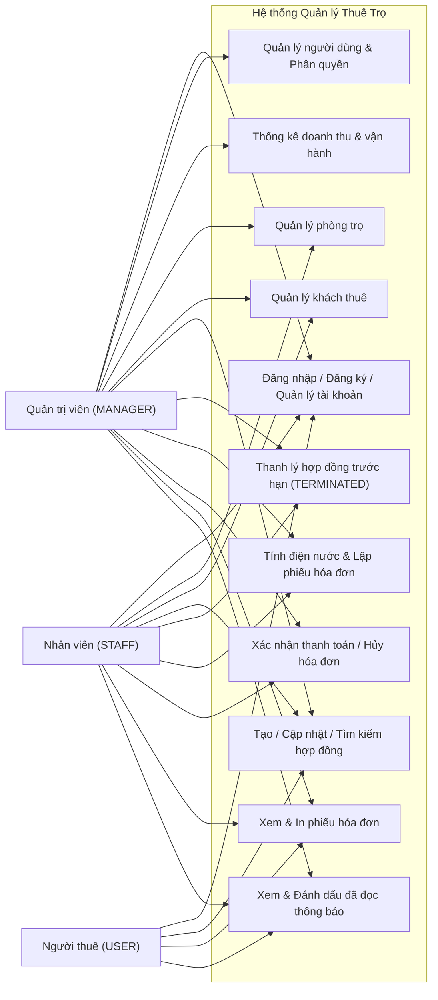
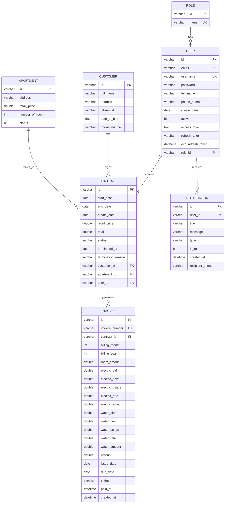
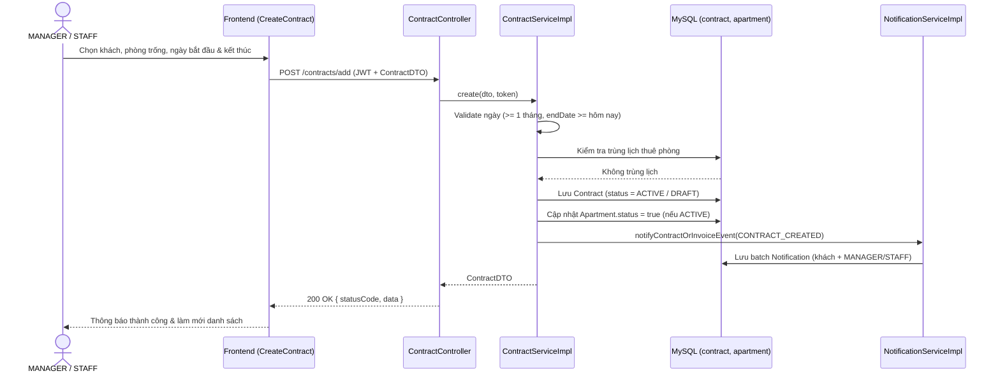
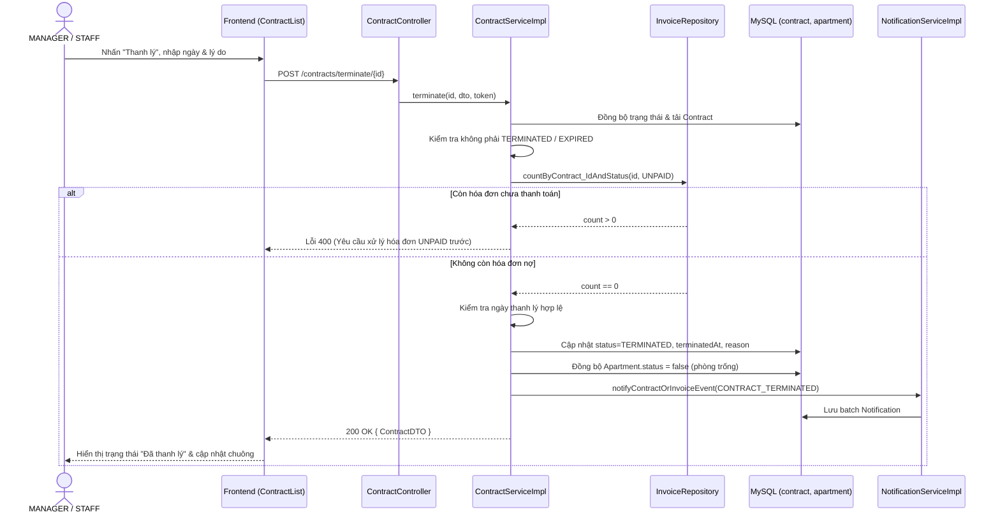
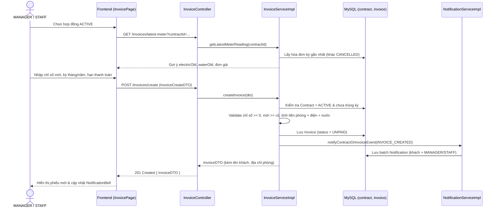

# CHƯƠNG 2: PHÂN TÍCH VÀ THIẾT KẾ HỆ THỐNG

## 2.1. Khảo sát và đặc tả yêu cầu hệ thống

Hệ thống **Quản lý Thuê Trọ** được xây dựng theo mô hình Client–Server (SPA React + RESTful API Spring Boot + MySQL 8), phục vụ toàn bộ quy trình vận hành nhà trọ: quản lý phòng, khách thuê, lập và thanh lý hợp đồng, tính tiền điện nước hàng tháng, phát hành phiếu hóa đơn và gửi thông báo tự động.

### 2.1.1. Yêu cầu chức năng

Hệ thống chia thành 6 phân hệ nghiệp vụ chính:

1. **Quản lý xác thực và phân quyền (Authentication & RBAC)**
   - Đăng ký tài khoản mới (mặc định vai trò `USER`, kiểm tra trùng email và số điện thoại).
   - Đăng nhập bằng tên đăng nhập hoặc email, cấp cặp JWT Access Token và Refresh Token.
   - Tự động làm mới Access Token khi hết hạn, đăng xuất thu hồi phiên làm việc.
   - Cập nhật thông tin tài khoản cá nhân (họ tên, email, số điện thoại nhận thông báo) và đổi mật khẩu.

2. **Quản lý người dùng (User Management — dành cho `MANAGER`)**
   - Xem danh sách, tạo mới, cập nhật vai trò (`MANAGER`, `STAFF`, `USER`), khóa/mở khóa tài khoản và thống kê số lượng tài khoản.

3. **Quản lý phòng trọ (Apartment Management)**
   - Thêm, sửa, xóa, tìm kiếm, phân trang và import danh sách phòng trọ.
   - Lọc danh sách phòng còn trống (`available=true`) khi lập hợp đồng mới.
   - Tự động đồng bộ trạng thái phòng (`Còn trống` / `Đã thuê`) khi hợp đồng được tạo, cập nhật, hết hạn hoặc thanh lý trước hạn.

4. **Quản lý khách thuê (Customer Management)**
   - Quản lý hồ sơ khách thuê gồm: họ tên, địa chỉ, số CCCD, ngày sinh, số điện thoại.
   - Hỗ trợ tìm kiếm, phân trang và import dữ liệu hàng loạt.

5. **Quản lý hợp đồng thuê phòng (Contract Management)**
   - Tạo hợp đồng mới: chọn khách thuê, phòng còn trống, ngày bắt đầu và ngày kết thúc (tối thiểu 1 tháng); hệ thống kiểm tra trùng lịch thuê, tự tính tổng giá trị hợp đồng, gán trạng thái ban đầu (`DRAFT` nếu ngày bắt đầu ở tương lai, `ACTIVE` nếu đang có hiệu lực), cập nhật trạng thái phòng và phát thông báo `CONTRACT_CREATED`.
   - Cập nhật hợp đồng (chỉ cho phép với hợp đồng chưa thanh lý); tự động tính lại giá trị và đồng bộ trạng thái phòng khi đổi phòng.
   - **Thanh lý hợp đồng trước hạn (`TERMINATED`)**: chỉ dành cho `MANAGER`/`STAFF`; kiểm tra không còn hóa đơn `UNPAID` tồn đọng, kiểm tra ngày thanh lý hợp lệ, lưu `terminated_at` và `termination_reason`, chuyển trạng thái sang `TERMINATED`, giải phóng phòng về trạng thái trống và gửi thông báo `CONTRACT_TERMINATED`.
   - Tự động đồng bộ hợp đồng quá hạn (`end_date < hôm nay`) sang `EXPIRED` và hợp đồng `DRAFT` đến hạn sang `ACTIVE`.
   - Phân quyền phạm vi dữ liệu: `USER` chỉ được xem/tìm kiếm các hợp đồng thuộc tài khoản hoặc trùng số điện thoại của mình.

6. **Quản lý hóa đơn điện nước & Thông báo (Invoice & Notification Management)**
   - **Gợi ý chỉ số điện nước kỳ trước**: tự động lấy chỉ số mới của hóa đơn gần nhất làm chỉ số cũ cho kỳ hiện tại.
   - **Tính tiền điện nước và tạo phiếu hóa đơn**: tính tiêu thụ điện (`electricNew - electricOld`), tiêu thụ nước (`waterNew - waterOld`), cộng tiền phòng (`retailPrice`) để ra tổng tiền; kiểm tra không trùng kỳ `(contract_id, billing_month, billing_year)` và chỉ cho phép tạo với hợp đồng `ACTIVE`.
   - **Quản lý trạng thái hóa đơn**: xác nhận đã thanh toán (`UNPAID` → `PAID`, lưu thời điểm `paid_at`, chống thanh toán lặp) hoặc hủy hóa đơn chưa thanh toán (`UNPAID` → `CANCELLED`).
   - **Xem và in phiếu báo tiền**: hiển thị đầy đủ thông tin phòng, khách thuê, chỉ số cũ/mới, thành tiền từng khoản và hỗ trợ in phiếu trực tiếp.
   - **Hệ thống thông báo**: tự động tạo thông báo trong bảng `notification` khi tạo/sửa/thanh lý hợp đồng, lập hóa đơn mới, thanh toán hoặc hủy hóa đơn; hiển thị số tin chưa đọc trên chuông thông báo, hỗ trợ đánh dấu đọc từng tin và đánh dấu đọc tất cả.

### 2.1.2. Yêu cầu phi chức năng

- **Bảo mật**: Mật khẩu mã hóa bằng `BCrypt`; xác thực stateless bằng JWT kết hợp kiểm tra phiên trong CSDL; kiểm soát quyền ở cả lớp Controller (`@PreAuthorize`) và lớp Service (data-level scoping theo `username` và `phoneNumber`).
- **Toàn vẹn dữ liệu**: Các thao tác đa bảng (lưu hợp đồng + đồng bộ phòng + gửi thông báo; lưu hóa đơn + gửi thông báo) đều thực thi trong `@Transactional`; ràng buộc `UNIQUE` ở mức CSDL trên `(contract_id, billing_month, billing_year)` và `invoice_number`.
- **Hiệu năng**: Tất cả danh sách đều hỗ trợ phân trang (`Pageable`) và bộ lọc phía server; đánh chỉ mục (`INDEX`) trên các cột truy vấn thường xuyên (`recipient_phone`, `user_id`, `is_read`, `status`, `billing_year`, `billing_month`).
- **Tính khả dụng và giao diện**: Giao diện Material UI thống nhất tiếng Việt, hỗ trợ responsive trên desktop/mobile, phản hồi trạng thái rõ ràng qua toast và dialog xác nhận.

---

## 2.2. Phân tích nghiệp vụ và biểu đồ Use Case

### 2.2.1. Xác định tác nhân và ma trận phân quyền

| Chức năng | Quản trị viên (`MANAGER`) | Nhân viên (`STAFF`) | Người thuê (`USER`) |
| :--- | :---: | :---: | :---: |
| Đăng nhập / Đăng ký / Đổi mật khẩu / Sửa tài khoản | Có | Có | Có |
| Quản lý tài khoản người dùng & Thống kê tổng quan | Có | Không | Không |
| Xem / Thêm / Sửa phòng trọ & khách hàng | Có | Có | Chỉ xem phòng |
| Xóa phòng trọ / khách hàng / hợp đồng | Có | Không | Không |
| Tạo / Sửa / Thanh lý hợp đồng trước hạn (`TERMINATED`) | Có | Có | Không |
| Xem / Tìm kiếm hợp đồng | Tất cả | Tất cả | Chỉ HĐ của mình |
| Lập hóa đơn điện nước / Xác nhận thanh toán / Hủy hóa đơn | Có | Có | Không |
| Xem / In phiếu hóa đơn | Tất cả | Tất cả | Chỉ hóa đơn của mình |
| Nhận & đánh dấu đã đọc thông báo | Có | Có | Có |

### 2.2.2. Biểu đồ Use Case tổng quát

### 2.2.3. Đặc tả chi tiết các Use Case trọng tâm

#### UC-01: Tạo hợp đồng thuê phòng
- **Tác nhân**: `MANAGER`, `STAFF`.
- **Tiền điều kiện**: Đã đăng nhập hợp lệ; đã tồn tại khách thuê và phòng trọ còn trống.
- **Luồng sự kiện chính**:
  1. Người dùng mở màn hình `/contracts/add`, chọn khách thuê, phòng trọ còn trống, ngày bắt đầu và ngày kết thúc.
  2. Giao diện tự động tính số tháng và tổng giá trị dự kiến (`số tháng × giá phòng`).
  3. Người dùng nhấn **Tạo hợp đồng**, gửi `POST /contracts/add`.
  4. Backend kiểm tra dữ liệu đầu vào (`endDate >= startDate + 1 tháng`, `endDate >= hôm nay`), kiểm tra phòng không bị trùng lịch với hợp đồng `ACTIVE`/`DRAFT` khác.
  5. Backend lưu bản ghi `contract` với trạng thái `ACTIVE` (hoặc `DRAFT` nếu `startDate > hôm nay`), đồng bộ `apartment.status = true` nếu `ACTIVE`.
  6. Backend tạo thông báo `CONTRACT_CREATED` cho khách thuê (khớp SĐT) và nhóm `MANAGER`/`STAFF`.
  7. Hệ thống trả về thông tin hợp đồng và cập nhật lại danh sách.
- **Luồng ngoại lệ**: Phòng đang có hợp đồng trùng thời gian hoặc ngày không hợp lệ → hệ thống trả lỗi `400` và hiển thị thông báo chi tiết.

#### UC-02: Thanh lý hợp đồng trước hạn (`TERMINATED`)
- **Tác nhân**: `MANAGER`, `STAFF`.
- **Tiền điều kiện**: Hợp đồng đang ở trạng thái `ACTIVE` hoặc `DRAFT`.
- **Luồng sự kiện chính**:
  1. Tại danh sách `/contracts`, người dùng nhấn nút **Thanh lý** ở dòng hợp đồng tương ứng.
  2. Nhập ngày thanh lý (`terminatedAt`) và lý do (`reason`), xác nhận gọi `POST /contracts/terminate/{id}`.
  3. Backend đồng bộ trạng thái hợp đồng, từ chối nếu hợp đồng đã `TERMINATED` hoặc `EXPIRED`.
  4. Backend kiểm tra số hóa đơn `UNPAID` của hợp đồng; nếu còn nợ chưa thanh toán thì từ chối và yêu cầu xử lý hóa đơn trước.
  5. Backend kiểm tra ngày thanh lý hợp lệ (`startDate <= terminatedAt <= endDate` đối với `ACTIVE`; `terminatedAt <= endDate` đối với `DRAFT`).
  6. Cập nhật `status = TERMINATED`, `terminated_at`, `termination_reason`; giải phóng phòng (`apartment.status = false` nếu không còn hợp đồng `ACTIVE` khác).
  7. Gửi thông báo `CONTRACT_TERMINATED` cho khách thuê và nhân viên quản lý.

#### UC-03: Tính tiền điện nước, lập phiếu hóa đơn & gửi thông báo
- **Tác nhân**: `MANAGER`, `STAFF`.
- **Tiền điều kiện**: Có ít nhất một hợp đồng đang ở trạng thái `ACTIVE`.
- **Luồng sự kiện chính**:
  1. Người dùng vào trang `/invoices`, chọn hợp đồng `ACTIVE`.
  2. Frontend gọi `GET /invoices/latest-meter?contractId=...` để tự điền chỉ số điện/nước cũ và đơn giá kỳ gần nhất.
  3. Người dùng chọn tháng/năm, hạn thanh toán, nhập chỉ số điện mới và nước mới; hệ thống hiển thị tạm tính theo công thức:
     $$\text{Tổng tiền} = \text{Tiền phòng} + (\text{Điện mới} - \text{Điện cũ}) \times \text{Đơn giá điện} + (\text{Nước mới} - \text{Nước cũ}) \times \text{Đơn giá nước}$$
  4. Người dùng nhấn **Tạo phiếu hóa đơn & Gửi thông báo**, gửi `POST /invoices/create`.
  5. Backend kiểm tra hợp đồng phải `ACTIVE`, chưa tồn tại hóa đơn cho cặp `(contract_id, billing_month, billing_year)`, chỉ số không âm, chỉ số mới $\ge$ chỉ số cũ, hạn thanh toán $\ge$ ngày lập.
  6. Backend sinh mã hóa đơn `INV-YYYY-MM-XXXXXXXX`, lưu bản ghi `invoice` ở trạng thái `UNPAID`.
  7. Backend gửi thông báo `INVOICE_CREATED` kèm số tiền và hạn thanh toán tới khách thuê và ban quản lý.

---

## 2.3. Thiết kế cơ sở dữ liệu

### 2.3.1. Mô hình thực thể kết hợp (ERD)

### 2.3.2. Đặc tả chi tiết các bảng dữ liệu chính

#### 1. Bảng `contract` (Hợp đồng thuê phòng)

| Tên cột | Kiểu dữ liệu | Ràng buộc | Mô tả |
| :--- | :--- | :--- | :--- |
| `id` | `VARCHAR(36)` | `PK` | Mã UUID hợp đồng |
| `start_date` | `DATE` | `NOT NULL` | Ngày bắt đầu thuê |
| `end_date` | `DATE` | `NOT NULL` | Ngày kết thúc hợp đồng |
| `create_date` | `DATE` | `NOT NULL` | Ngày lập hợp đồng (auto `@CreatedDate`) |
| `retail_price` | `DOUBLE` | `NOT NULL` | Giá thuê phòng/tháng tại thời điểm ký |
| `total` | `DOUBLE` | `NOT NULL` | Tổng giá trị hợp đồng (`số tháng × giá thuê`) |
| `status` | `VARCHAR(20)` | `NOT NULL, INDEX` | Trạng thái: `DRAFT`, `ACTIVE`, `EXPIRED`, `TERMINATED` |
| `terminated_at` | `DATE` | `NULL` | Ngày thanh lý hợp đồng trước hạn |
| `termination_reason` | `VARCHAR(1000)` | `NULL` | Lý do thanh lý hợp đồng |
| `customer_id` | `VARCHAR(36)` | `FK → customer(id), INDEX` | Khách thuê đứng tên hợp đồng |
| `apartment_id` | `VARCHAR(36)` | `FK → apartment(id), INDEX` | Phòng trọ được thuê |
| `user_id` | `VARCHAR(36)` | `FK → user(id)` | Tài khoản lập hợp đồng |

#### 2. Bảng `invoice` (Hóa đơn điện nước hàng tháng — bổ sung mới)

| Tên cột | Kiểu dữ liệu | Ràng buộc | Mô tả |
| :--- | :--- | :--- | :--- |
| `id` | `VARCHAR(36)` | `PK` | Mã UUID hóa đơn |
| `invoice_number` | `VARCHAR(100)` | `NOT NULL, UNIQUE` | Mã phiếu hóa đơn (`INV-YYYY-MM-XXXXXXXX`) |
| `contract_id` | `VARCHAR(36)` | `FK → contract(id), NOT NULL` | Hợp đồng phát sinh hóa đơn |
| `billing_month` | `INT` | `NOT NULL` | Tháng tính cước (1–12) |
| `billing_year` | `INT` | `NOT NULL` | Năm tính cước |
| `room_amount` | `DOUBLE` | `NOT NULL` | Tiền thuê phòng tháng |
| `electric_old` | `DOUBLE` | `DEFAULT 0` | Chỉ số điện cũ (kWh) |
| `electric_new` | `DOUBLE` | `DEFAULT 0` | Chỉ số điện mới (kWh) |
| `electric_usage` | `DOUBLE` | `DEFAULT 0` | Số điện tiêu thụ (`electric_new - electric_old`) |
| `electric_rate` | `DOUBLE` | `NOT NULL` | Đơn giá điện (VNĐ/kWh, mặc định `3000`) |
| `electric_amount` | `DOUBLE` | `NOT NULL` | Thành tiền điện (`electric_usage × electric_rate`) |
| `water_old` | `DOUBLE` | `DEFAULT 0` | Chỉ số nước cũ (m³) |
| `water_new` | `DOUBLE` | `DEFAULT 0` | Chỉ số nước mới (m³) |
| `water_usage` | `DOUBLE` | `DEFAULT 0` | Số nước tiêu thụ (`water_new - water_old`) |
| `water_rate` | `DOUBLE` | `NOT NULL` | Đơn giá nước (VNĐ/m³, mặc định `10000`) |
| `water_amount` | `DOUBLE` | `NOT NULL` | Thành tiền nước (`water_usage × water_rate`) |
| `amount` | `DOUBLE` | `NOT NULL` | Tổng số tiền phải thanh toán |
| `issue_date` | `DATE` | `NOT NULL` | Ngày phát hành hóa đơn |
| `due_date` | `DATE` | `NOT NULL` | Hạn thanh toán |
| `status` | `VARCHAR(20)` | `NOT NULL, INDEX` | Trạng thái: `UNPAID`, `PAID`, `CANCELLED` |
| `paid_at` | `DATETIME(6)` | `NULL` | Thời điểm xác nhận đã thanh toán |
| `created_at` | `DATETIME(6)` | `NULL` | Thời điểm tạo bản ghi |

> **Ràng buộc duy nhất tổ hợp**: `UNIQUE (contract_id, billing_month, billing_year)` đảm bảo mỗi hợp đồng chỉ có duy nhất một phiếu hóa đơn cho mỗi kỳ tháng/năm.

#### 3. Bảng `notification` (Thông báo — bổ sung mới)

| Tên cột | Kiểu dữ liệu | Ràng buộc | Mô tả |
| :--- | :--- | :--- | :--- |
| `id` | `VARCHAR(36)` | `PK` | Mã UUID thông báo |
| `user_id` | `VARCHAR(36)` | `FK → user(id), NOT NULL` | Tài khoản liên kết nhận thông báo |
| `title` | `VARCHAR(255)` | `NOT NULL` | Tiêu đề thông báo |
| `message` | `VARCHAR(1000)` | `NOT NULL` | Nội dung chi tiết thông báo |
| `type` | `VARCHAR(40)` | `NOT NULL` | Loại sự kiện (`CONTRACT_CREATED`, `CONTRACT_UPDATED`, `CONTRACT_TERMINATED`, `INVOICE_CREATED`, `INVOICE_PAID`, `UTILITY_INVOICE_CREATED`, `SYSTEM`) |
| `is_read` | `BIT(1)` | `NOT NULL, DEFAULT 0` | Trạng thái đã đọc (`0`: chưa đọc, `1`: đã đọc) |
| `created_at` | `DATETIME(6)` | `NOT NULL, INDEX` | Thời điểm phát sinh thông báo |
| `recipient_phone` | `VARCHAR(20)` | `NULL, INDEX` | Số điện thoại định tuyến thông báo khớp với khách thuê |

#### 4. Các bảng danh mục nền tảng (`role`, `user`, `apartment`, `customer`)

- `role`: lưu 3 vai trò chuẩn `MANAGER`, `STAFF`, `USER`.
- `user`: lưu thông tin đăng nhập, mật khẩu mã hóa BCrypt, `phone_number` (kiểm tra duy nhất ở tầng Service để định tuyến thông báo và phạm vi hợp đồng/hóa đơn an toàn), access/refresh token.
- `apartment`: lưu địa chỉ phòng, giá thuê (`retail_price`), số phòng (`number_of_room`), trạng thái (`status`: `false` trống, `true` đang thuê).
- `customer`: lưu thông tin định danh khách thuê (`full_name`, `citizen_id`, `date_of_birth`, `phone_number`, `address`).

> Script khởi tạo đầy đủ toàn bộ 7 bảng kèm ràng buộc và chỉ mục được lưu tại [docs/schema.sql](./schema.sql).

---

## 2.4. Thiết kế luồng xử lý (Biểu đồ tuần tự)

### 2.4.1. Luồng tạo hợp đồng và đồng bộ trạng thái phòng

### 2.4.2. Luồng thanh lý hợp đồng trước hạn (`TERMINATED`)

### 2.4.3. Luồng tính tiền điện nước, tạo phiếu hóa đơn & gửi thông báo

---

## 2.5. Thiết kế kiến trúc hệ thống và đặc tả REST API

### 2.5.1. Kiến trúc phân lớp hệ thống

```mermaid
flowchart LR
    subgraph Client["Frontend (React 18 + TypeScript + MUI 5 + React Query)"]
        UI["Pages / Components<br/>(ContractList, CreateContract, InvoicePage, NotificationBell)"]
        HOOK["React Query Hooks<br/>(contract.ts, invoice.ts)"]
        AXIOS["Axios Client<br/>(privateInstance + JWT Interceptor)"]
        UI --> HOOK --> AXIOS
    end

    subgraph Server["Backend (Spring Boot 2.7 + Spring Security + JPA)"]
        FILTER["JwtAuthFilter & @PreAuthorize"]
        CTRL["REST Controllers<br/>(Contract, Invoice, Notification)"]
        SVC["Service Layer (@Transactional)<br/>(ContractService, InvoiceService, NotificationService)"]
        REPO["Spring Data JPA Repositories"]
        FILTER --> CTRL --> SVC --> REPO
    end

    DB[("MySQL 8<br/>Quan_Ly_Phong")]

    AXIOS -- "HTTP/JSON + Bearer JWT" --> FILTER
    REPO -- "Hibernate ORM" --> DB
```

### 2.5.2. Đặc tả các REST API trọng tâm

#### Nhóm API Hợp đồng (`/contracts`)

| Phương thức | Đường dẫn | Phân quyền | Mô tả chức năng |
| :--- | :--- | :--- | :--- |
| `GET` | `/contracts` | Đã đăng nhập | Danh sách hợp đồng có phân trang (`USER` chỉ thấy HĐ của mình) |
| `GET` | `/contracts/{id}` | Đã đăng nhập | Chi tiết hợp đồng (kiểm tra quyền sở hữu đối với `USER`) |
| `GET` | `/contracts/search?q=...` | Đã đăng nhập | Tìm kiếm theo địa chỉ phòng, tên/SĐT khách, trạng thái (có lọc theo `USER`) |
| `POST` | `/contracts/add` | `MANAGER`, `STAFF` | Tạo hợp đồng mới, đồng bộ trạng thái phòng và gửi thông báo |
| `POST` | `/contracts/update/{id}` | `MANAGER`, `STAFF` | Cập nhật hợp đồng (chặn chỉnh sửa HĐ đã `TERMINATED`) |
| `POST` | `/contracts/terminate/{id}` | `MANAGER`, `STAFF` | Thanh lý hợp đồng trước hạn (`TERMINATED`), kiểm tra nợ hóa đơn, giải phóng phòng |
| `DELETE` | `/contracts/delete/{id}` | `MANAGER` | Xóa hợp đồng không còn `ACTIVE` và chưa phát sinh hóa đơn |

#### Nhóm API Hóa đơn điện nước (`/invoices`)

| Phương thức | Đường dẫn | Phân quyền | Mô tả chức năng |
| :--- | :--- | :--- | :--- |
| `GET` | `/invoices` | Đã đăng nhập | Danh sách hóa đơn phân trang, lọc theo `status`, `billingMonth`, `billingYear`, `contractId` |
| `GET` | `/invoices/{id}` | Đã đăng nhập | Xem chi tiết phiếu hóa đơn (kiểm tra quyền với `USER`) |
| `GET` | `/invoices/latest-meter?contractId=...` | `MANAGER`, `STAFF` | Gợi ý chỉ số điện/nước cũ và đơn giá từ hóa đơn kỳ gần nhất |
| `POST` | `/invoices/create` | `MANAGER`, `STAFF` | Tính tiền điện nước, phát hành phiếu hóa đơn `UNPAID` và gửi thông báo |
| `POST` | `/invoices/{id}/pay` | `MANAGER`, `STAFF` | Xác nhận thanh toán (`PAID`), lưu `paidAt` và gửi thông báo `INVOICE_PAID` |
| `POST` | `/invoices/{id}/cancel` | `MANAGER`, `STAFF` | Hủy hóa đơn đang ở trạng thái `UNPAID` sang `CANCELLED` |

#### Nhóm API Thông báo (`/notifications`)

| Phương thức | Đường dẫn | Phân quyền | Mô tả chức năng |
| :--- | :--- | :--- | :--- |
| `GET` | `/notifications` | Đã đăng nhập | Danh sách thông báo kèm tổng số chưa đọc (`unreadCount`) |
| `POST` | `/notifications/{id}/read` | Đã đăng nhập | Đánh dấu 1 thông báo đã đọc (kiểm tra quyền sở hữu) |
| `POST` | `/notifications/read-all` | Đã đăng nhập | Đánh dấu toàn bộ thông báo của tài khoản hiện tại là đã đọc |

---

## 2.6. Thiết kế giao diện người dùng (UI/UX)

### 2.6.1. Sơ đồ điều hướng chính

- Thanh điều hướng trên cùng (`Layout.jsx`): **Overview** (`/`), **Customers** (`/customers` — `MANAGER`/`STAFF`), **Apartments** (`/apartments`), **Contracts** (`/contracts`), **Invoices** (`/invoices`), **Users** (`/users` — `MANAGER`), kèm **NotificationBell** và menu tài khoản cá nhân.

### 2.6.2. Giao diện Quản lý Hợp đồng (`/contracts`, `/contracts/add`, `/contracts/:id/edit`)

- **Bảng danh sách hợp đồng (`ContractList`)**: Sử dụng Material React Table hỗ trợ tìm kiếm server-side, sắp xếp, phân trang và mở rộng hàng (`DetailPanel`).
  - Các cột chính: *Khách thuê*, *Phòng trọ*, *Giá thuê/tháng*, *Tổng giá trị*, *Thời hạn thuê*, *Trạng thái* (hiển thị bằng `Chip` phân màu: xanh lá `Đang hiệu lực`, vàng `Chờ hiệu lực`, xám `Đã hết hạn`, đỏ `Đã thanh lý`).
  - **DetailPanel mở rộng**: chia 3 cột trực quan gồm *Thông tin hợp đồng*, *Khách thuê & Phòng trọ*, và *Thông tin thanh lý trước hạn* (hiển thị cảnh báo đỏ gồm ngày thanh lý & lý do nếu `TERMINATED`).
  - **Hộp thoại Thanh lý trước hạn**: hiển thị tóm tắt hợp đồng, chọn ngày thanh lý có hướng dẫn khoảng hợp lệ, ô nhập lý do và nút xác nhận có trạng thái loading.
- **Màn hình Tạo / Sửa hợp đồng (`CreateContract`, `EditContract`)**:
  - Bố cục dạng `Card` gọn gàng, chọn khách hàng & phòng trọ bằng `Autocomplete` (tự lọc phòng còn trống khi tạo mới), chọn ngày bằng `DatePicker` định dạng `DD-MM-YYYY`, hiển thị hộp tạm tính *Giá phòng × Số tháng = Tổng giá trị dự kiến* theo thời gian thực.

### 2.6.3. Giao diện Hóa đơn điện nước (`/invoices`) và Thông báo (`NotificationBell`)

- **Khu vực lập phiếu hóa đơn** (dành cho `MANAGER`/`STAFF`):
  - Chọn hợp đồng `ACTIVE` → tự động điền chỉ số điện/nước cũ từ kỳ trước kèm thông báo gợi ý.
  - Nhập kỳ tháng/năm, hạn thanh toán, chỉ số điện/nước mới, đơn giá → hiển thị cảnh báo ngay nếu chỉ số mới < cũ và tính trực tiếp tiền phòng + tiền điện + tiền nước = Tổng cộng.
- **Thanh lọc & Thống kê nhanh**: lọc theo trạng thái (`UNPAID`/`PAID`/`CANCELLED`), tháng, năm; hiển thị tổng số phiếu, tổng đã thu và chưa thu.
- **Thẻ phiếu hóa đơn & Hộp thoại In phiếu**:
  - Mỗi thẻ hiển thị mã phiếu, kỳ, trạng thái, cảnh báo *Quá hạn* nếu quá `dueDate`, địa chỉ phòng, tên & SĐT khách thuê, chi tiết chỉ số cũ → mới và thành tiền từng mục.
  - Tích hợp hộp thoại **Xem / In phiếu báo tiền** dạng bảng chuẩn hóa đơn có nút `In phiếu`, cùng các thao tác **Đã thanh toán** và **Hủy** (có hộp thoại xác nhận).
- **Chuông thông báo (`NotificationBell`)**: hiển thị badge số lượng tin chưa đọc, tự cập nhật mỗi 15 giây và ngay lập tức sau mỗi thao tác tạo/thanh lý hợp đồng hoặc tạo/thanh toán hóa đơn; phân loại bằng nhãn màu và hỗ trợ nút **Đọc tất cả**.
